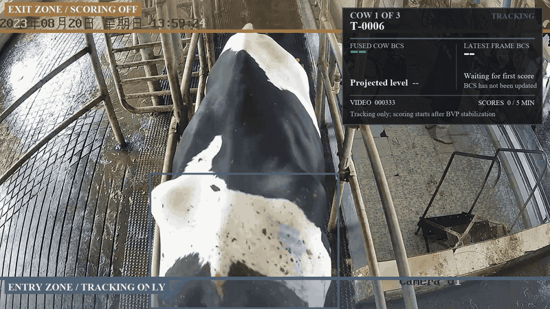

# BCS — Dairy Cow Body Condition Scoring

This repository provides testing videos of dairy cows for Body Condition Scoring (BCS), together with a result showcase.

## Result preview

A preview of cows **T-0006, T-0011, and T-0015**, showing the tracking/scoring regions and the BCS values displayed in the result video. Click the animation to open the clearer MP4 preview.

[MP4 preview](assets/bcs-demo.mp4) · [Full result video](https://github.com/LittleForest-Ming/BCS/releases/download/test-videos-v1/multi_cow_showcase_T-0006_T-0011_T-0015.mp4)

## Downloads

The original videos and ZIP archive are available in [Releases](https://github.com/LittleForest-Ming/BCS/releases/tag/test-videos-v1). Download the ZIP for all four original videos, or download them individually below.

| File | Content | Size |
| --- | --- | ---: |
| [test_video.zip](https://github.com/LittleForest-Ming/BCS/releases/download/test-videos-v1/test_video.zip) | Complete archive | 634.8 MiB |
| [D01_20230814130222_01.mp4](https://github.com/LittleForest-Ming/BCS/releases/download/test-videos-v1/D01_20230814130222_01.mp4) | Test video | 191.2 MiB |
| [D01_20230814130222_02.mp4](https://github.com/LittleForest-Ming/BCS/releases/download/test-videos-v1/D01_20230814130222_02.mp4) | Test video | 214.1 MiB |
| [D01_20230814134850_01.mp4](https://github.com/LittleForest-Ming/BCS/releases/download/test-videos-v1/D01_20230814134850_01.mp4) | Test video | 193.1 MiB |
| [multi_cow_showcase_T-0006_T-0011_T-0015.mp4](https://github.com/LittleForest-Ming/BCS/releases/download/test-videos-v1/multi_cow_showcase_T-0006_T-0011_T-0015.mp4) | Full result showcase | 36.9 MiB |

Original files are provided without re-encoding. The ZIP retains its existing folder structure (`test_video/test_video/`), including the original `resuts` and `test video` folder names. [SHA256SUMS.txt](SHA256SUMS.txt) provides checksums for the five original downloads.

The preview joins three excerpts from the result video: **1–4 s, 9–12 s, and 15–18 s**. The GIF is 800 × 450 at 8 fps; the MP4 preview is 1280 × 720 at 30 fps. Only the previews are shortened and resized.

More full-length test videos will be uploaded over time.
